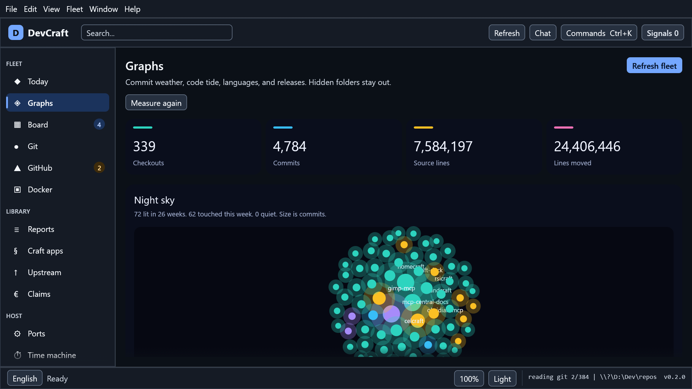
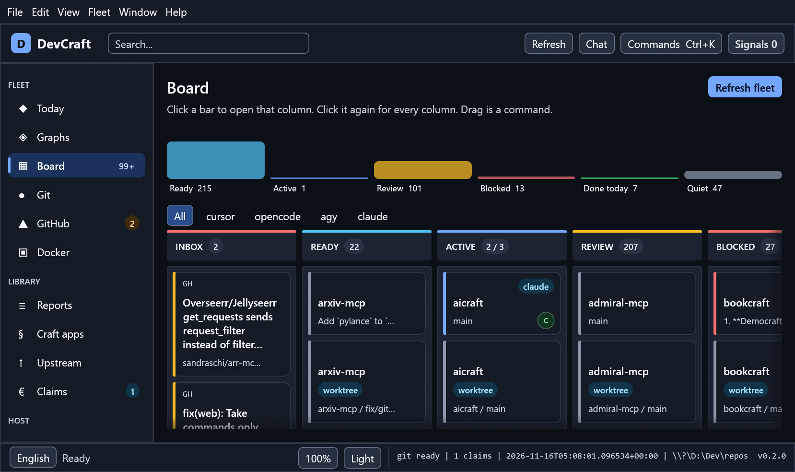

# DevCraft


## Install

Tell Cursor, Claude, Antigravity, or OpenCode: **Install this.**

```powershell
powershell -NoProfile -ExecutionPolicy Bypass -File scripts\install-craft.ps1
```

Installs the Windows app and the CLI (Start Menu shortcut, CLI on the user PATH). `-RegisterClients` also registers the MCP exe with the IDEs that are installed. `-Clients cursor,claude-desktop` limits that list. `-Mcpb` installs the Claude Desktop extension bundle.

## Window


Today is the morning digest. The board and the reports are already on disk.



Graphs is the night sky of the fleet. A circle is a checkout. Size is commits over 26 weeks.



The board is the live kanban. Click a bar to open that column.

Local fleet cockpit for one person and four IDEs: Cursor, OpenCode, Antigravity, and Claude.

Status: **v0.2.0**. The window is the craft shell. It calls `devcraft-core` in-process. MCP stays on stdio. Nothing listens on a port.

CraftDeck installs apps. This checkout is the view of the fleet. TaskCraft keeps issues.

## Pages

Today, Graphs, Board, Git, GitHub, Docker, Reports, Craft apps, Upstream, Claims, Ports, Time machine, Sandbox, Services, Tasks, Logs, Telemetry, Workflows, LLM & Settings.

Window > Chat opens the right-hand dock. The prompt is the bundled skills. Graphs measures commits, source lines, languages, and tags. Workflows checks craft-app freshness and queues SOP requests.

Upstream is the Storytold clones in `_upstream`: commits and the diff from the last 24 hours, the newest tag, and the changelog tail. It does not fetch.

Today draws the morning digest (`mcp-central-docs/operations/fleet-status.md`) as charts and tables as soon as the window opens. Git status and Docker fill in behind that. Claims, pins, and snoozes are stored in `{workspace}/.devcraft`.

## Docs

- [PRD](docs/PRD.md)
- [Tier plan](docs/TIERED_PLAN.md)
- [Handover](HANDOVER.md)
- [Changelog](CHANGELOG.md)

## Commands

```powershell
cargo run -p devcraft-app -- --smoke
cargo run -p devcraft-app
cargo run -p devcraft-mcp -- --mcp
cargo run -p devcraft-mcp -- tool devcraft_status
cargo run -p devcraft-mcp -- tool devcraft_upstream
```

`devcraft_refresh` scans sibling checkouts. `devcraft_status` does not. `devcraft_upstream` reads `_upstream` and does not fetch.

## Layout

```text
devcraft/
  crates/devcraft-core/   board, digest, claims, ports, docker
  crates/devcraft-mcp/    CLI and MCP 2024-11-05 over stdio
  crates/devcraft-app/    egui window on craft-biz-ui
  docs/                   PRD and tier plan
```
