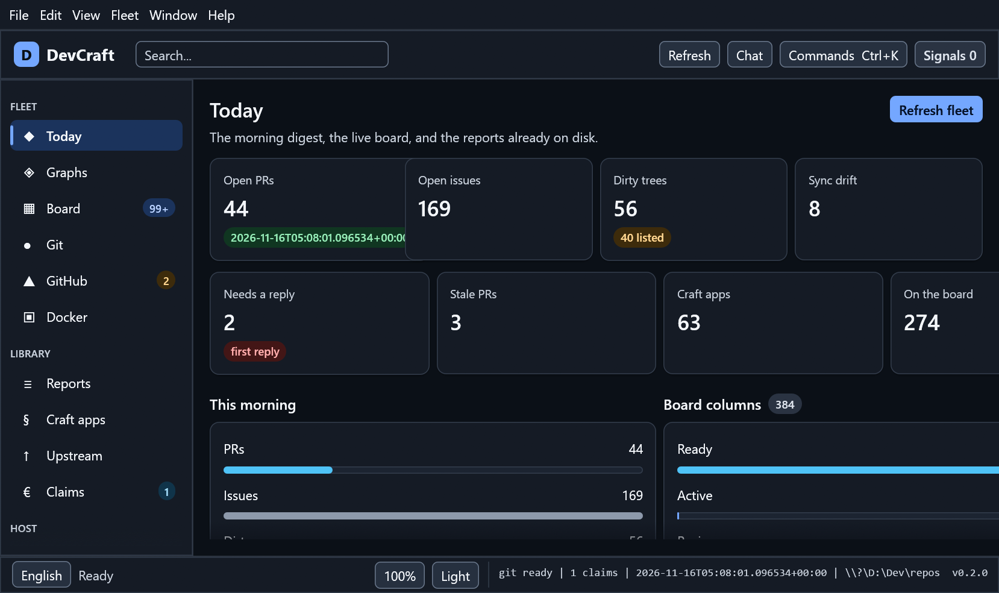

# DevCraft

Local fleet cockpit for one developer and four IDEs (Cursor, OpenCode, Antigravity, and Claude) that unifies repository health, a live Kanban board, git/GitHub digests, service sentinels, and an embedded Ollama chat dock.


## Preview

| Today Digest | Fleet Graphs | Kanban Board |
|--------------|--------------|--------------|
|  |  |  |

*Caption: Today's morning digest, 26-week commit activity night sky, and live fleet Kanban board.*

## What You Can Do

**How it runs:** Pure-Rust `egui` desktop window (`devcraft-app` on `craft-biz-ui`) calling `devcraft-core` in-process, paired with a CLI and pure-stdio MCP `2024-11-05` server (`devcraft-mcp`). Nothing listens on a port.

- **19-Page Fleet Cockpit:** Browse Today, Graphs, Board, Git, GitHub, Docker, Reports, Craft apps, Upstream, Claims, Ports, Time machine, Sandbox, Services, Tasks, Logs, Telemetry, Workflows, and LLM & Settings.
- **Morning Digest & Live Board:** Renders `mcp-central-docs/operations/fleet-status.md` immediately on launch, then fills in git status and Docker state behind it.
- **Upstream Storytold Tracker:** Inspects `_upstream` clones for 24-hour commits, diffs, newest tags, and changelog tails without fetching.
- **Claims, Ports & Sentinels:** Stores claims, pins, and snoozes in `{workspace}/.devcraft`, monitors port registries, and checks craft-app freshness.
- **AI Chat Dock (`Ctrl+J`) & Bundled Skills:** Press `Ctrl+J` (or **Window > Chat**) to open the Ollama chat dock pre-loaded with bundled skills (`devcraft-workflow`, `devcraft-sops`) and inline approval for any write tool call.
- **Command Palette (`Ctrl+K`) & Help Center:** Fuzzy-search any cockpit tool or UI action with schema-generated forms, plus built-in Help Center tabs.

## Install

1. Download **`devcraft-0.2.0-setup.exe`** from the [latest release](https://github.com/sandraschi/devcraft/releases/latest).
2. Run the installer (if Windows SmartScreen appears on an unsigned build, choose **More info > Run anyway**).
3. Launch **DevCraft** from the Start menu.

**Only want the MCP tools in Claude Desktop?** Download `devcraft-0.2.0.mcpb` from the same release and open it with Claude Desktop (this registers the MCP server only and does **not** install the desktop app):

> Install the devcraft MCP extension: download `devcraft-0.2.0.mcpb` from https://github.com/sandraschi/devcraft/releases/latest and open it with Claude Desktop.

**From a local checkout (Windows app and CLI):**

```powershell
powershell -NoProfile -ExecutionPolicy Bypass -File scripts\install-craft.ps1
```

Installs the Windows app and the CLI (Start Menu shortcut, CLI on the user PATH). `-RegisterClients` also registers the MCP exe with the IDEs that are installed. `-Clients cursor,claude-desktop` limits that list. `-Mcpb` installs the Claude Desktop extension bundle.

For source builds, `--smoke` checks, and `just` recipes, see [HELP.md](HELP.md) and [docs/PRD.md](docs/PRD.md).

## Example Prompts

> "Run `devcraft_status` and summarize any repos with dirty git trees or failing gates."

> "Check `devcraft_upstream` for new Storytold commits and tag updates in the last 24 hours."

> "Open the Board view and list all currently claimed repositories."

## Workspace Layout

```text
devcraft/
|-- crates/devcraft-core/   # L1: board, digest, claims, ports, docker, skills
|-- crates/devcraft-mcp/    # L2: CLI and MCP 2024-11-05 over stdio
|-- crates/devcraft-app/    # L3: egui window on craft-biz-ui
|-- skills/                 # Bundled devcraft-workflow and devcraft-sops skills
`-- docs/                   # PRD and tiered plan
```

## Documentation

| Doc | Contents |
|-----|----------|
| [Help & Operations Guide](HELP.md) | First-run tour, 19 pages, shortcuts (`Ctrl+J`, `Ctrl+K`), bundled skills |
| [PRD](docs/PRD.md) | Product requirements and cockpit architecture |
| [Tiered Plan](docs/TIERED_PLAN.md) | Milestone status and planned capabilities |
| [Handover](HANDOVER.md) | Recent session state and open items |
| [Changelog](CHANGELOG.md) | Release history |
| [Docs Folder](docs/) | Additional project documentation |

## Requirements

- Windows 10/11 64-bit
- Optional: local [Ollama](https://ollama.com/) instance for the `Ctrl+J` Fleet Copilot chat dock

## License

MIT OR Apache-2.0.
